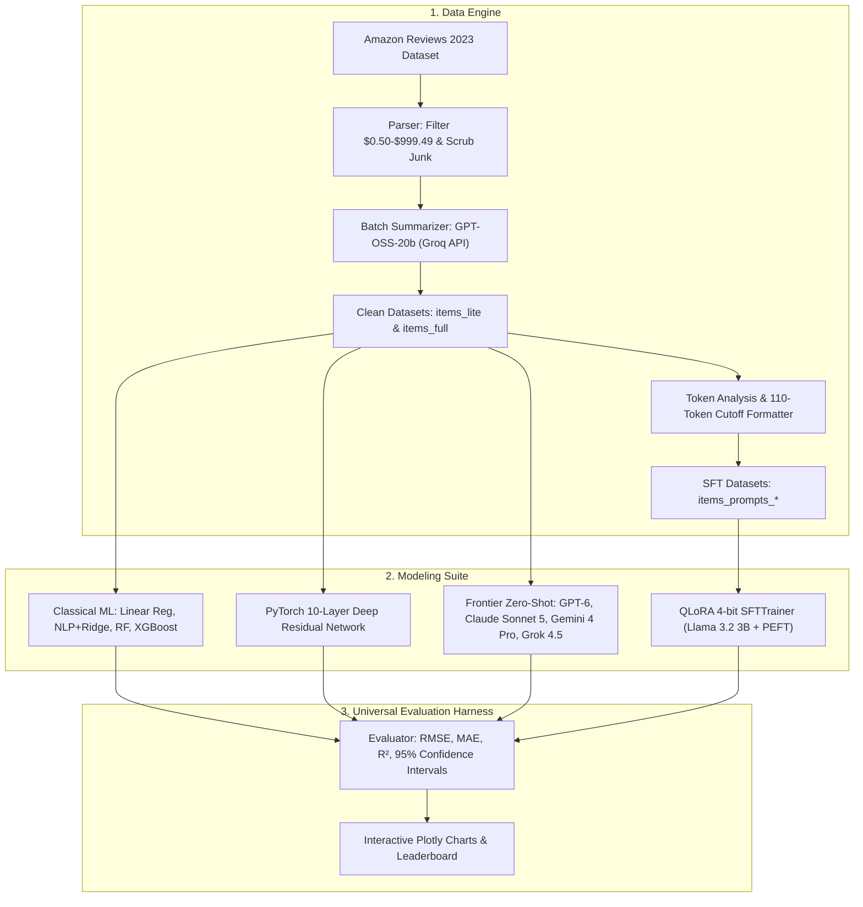

# 🏷️ The Price Is Right: AI Product Price Prediction

[](https://www.python.org/downloads/)
[](https://opensource.org/licenses/MIT)
[](https://huggingface.co/Aksh10)

An end-to-end Machine Learning and Generative AI system that predicts e-commerce product retail prices directly from titles, descriptions, and feature specifications.

This project implements and benchmarks a full continuum of AI techniques: naive heuristics, classical tabular and NLP regressors, tree ensembles, custom deep residual neural networks (ResNets), closed frontier models (GPT-6, Claude Sonnet 5, Gemini 4 Pro), and domain-adapted open-source models fine-tuned with **4-bit QLoRA** on Llama 3.2 3B.

---

## 🏆 Benchmark Leaderboard Highlights

Detailed metrics, residual plots, and error analyses are documented in [**`EVALS.md`**](file:///Users/rajdeeppatil/CS/LEARNING/AI/price-prediction/EVALS.md).

| Rank | Model Architecture | Paradigm | RMSE ($) | R² Score |
| :---: | :--- | :--- | :---: | :---: |
| **🥇** | **Fine-Tuned Llama 3.2 3B (Full)** | **Open-Source QLoRA** | **$39.85** | **85.9%** |
| 🥈 | **GPT-6** | Frontier Zero-Shot | $44.74 | 82.2% |
| 🥉 | **Deep Residual Network (PyTorch)** | Custom 10-Layer ResNet | $46.49 | 80.8% |
| 4 | Claude Sonnet 5 | Frontier Zero-Shot | $47.10 | 80.3% |
| 5 | Gemini 4 Pro | Frontier Zero-Shot | $50.54 | 77.3% |
| 6 | Grok 4.5 Fast | Frontier Zero-Shot | $57.62 | 70.6% |
| 7 | GPT-5 Nano | Frontier Zero-Shot | $62.51 | 65.4% |
| 8 | XGBoost Regressor | Gradient Boosted Trees | $68.23 | 58.9% |
| 9 | Random Forest Regressor | Tree Ensemble | $72.28 | 53.8% |
| 10 | NLP + Ridge Regression | Bag-of-Words TF-IDF | $76.81 | 47.8% |
| 11 | 🧑‍💼 **Human Expert Benchmark** | **Manual Assessment** | **$87.62** | **32.1%** |
| 12 | Linear Regression | Tabular Metadata | $101.56 | 9.4% |
| 13 | Constant Baseline | Dataset Mean ($68.42) | $106.18 | 0.0% |

> **Key Finding**: The domain-adapted open-source model (**Llama 3.2 3B + QLoRA**) outperformed all commercial frontier models—including GPT-6 and Claude Sonnet 5—at zero per-token API cost.

---

## 📐 System Architecture



---

## 🗂️ Project Structure

```text
price-prediction/
├── README.md                      # Project documentation and guide
├── EVALS.md                       # Comprehensive evaluation benchmark records
├── pyproject.toml                 # Package metadata and dependencies
├── requirements.txt               # Pinned Python requirements
├── .env.example                   # Environment variable template
├── .gitignore                     # Git ignore rules
├── app.py                         # Interactive Gradio Web Application
│
├── pricer/                        # Core Python Library
│   ├── __init__.py                # Package entrypoint
│   ├── config.py                  # Global configurations and constants
│   ├── data/                      # Ingestion, parsing, and prompt formatting
│   │   ├── __init__.py
│   │   ├── schema.py              # Pydantic Item schema and HuggingFace Hub tools
│   │   ├── parser.py              # Text cleaning, scrubbing, and price bounds
│   │   ├── loader.py              # Multi-processing Amazon review chunk loader
│   │   ├── summarizer.py          # LiteLLM product summarizer
│   │   ├── batch_processor.py     # Groq / OpenAI batch API processor
│   │   └── prompt_formatter.py    # Token distribution analysis & prompt curation
│   ├── models/                    # Modeling implementations
│   │   ├── __init__.py
│   │   ├── baselines.py           # Constant, Linear Reg, NLP+Ridge, RF, XGBoost, Human
│   │   ├── dnn.py                 # PyTorch 10-layer ResNet with HashingVectorizer
│   │   ├── frontier.py            # Commercial frontier zero-shot pricers (LiteLLM)
│   │   └── qlora_model.py         # 4-bit quantized base LLM + LoRA adapter loader
│   ├── training/                  # Automated training workflows
│   │   ├── __init__.py
│   │   ├── train_ml.py            # Train and evaluate classical ML models
│   │   ├── train_dnn.py           # Train PyTorch ResNet
│   │   └── train_qlora.py         # Full QLoRA SFTTrainer training loop
│   └── evaluation/                # Benchmarking and visual analytics
│       ├── __init__.py
│       ├── metrics.py             # RMSE, MAE, R², error distributions, CI
│       ├── evaluator.py           # Multi-threaded & GPU-safe benchmark runner
│       └── visualizer.py          # Interactive Plotly regression and leaderboard graphs
│
├── data/                          # Dataset files
│   ├── human_in.csv               # 200 holdout items for human testing
│   └── human_out.csv              # Human expert baseline predictions
│
├── notebooks/                     # Exploratory and interactive notebooks
│   ├── 01_data_pipeline.ipynb     # Data extraction, cleaning, and prompt generation
│   ├── 02_model_benchmarks.ipynb  # Comprehensive model evaluation & leaderboard
│   └── 03_qlora_training.ipynb    # Colab-ready QLoRA fine-tuning walkthrough
│
└── tests/                         # Unit tests
    ├── __init__.py
    └── test_pricer.py             # Validation for parser, schema, and metrics
```

---

## 🚀 Quickstart

### 1. Installation

```bash
# Clone the repository
git clone https://github.com/your-username/price-prediction.git
cd price-prediction

# Create and activate a virtual environment
python3 -m venv .venv
source .venv/bin/activate

# Install package in editable mode
pip install -e .
```

### 2. Environment Variables

Create your `.env` file from the provided template:

```bash
cp .env.example .env
```

Add your API keys:
- `HF_TOKEN`: Hugging Face Hub token (required for private model access and dataset uploading).
- `OPENAI_API_KEY`, `GROQ_API_KEY`, `ANTHROPIC_API_KEY`, `GEMINI_API_KEY`: For summarization and frontier benchmarks.
- `WANDB_API_KEY`: For tracking fine-tuning loss curves.

---

## 💻 Usage

### 1. Launch Interactive Web UI

Test price predictions interactively on any product title and description:

```bash
python app.py
```
Open [http://localhost:7860](http://localhost:7860) in your browser.

---

### 2. Run CLI Training Workflows

#### Train Classical Machine Learning Baselines:
```bash
python -m pricer.training.train_ml --dataset "Aksh10/items_lite" --size 200
```

#### Train PyTorch Deep Residual Neural Network:
```bash
python -m pricer.training.train_dnn --dataset "Aksh10/items_lite" --epochs 5
```

#### Train 4-bit QLoRA Adapter (Llama 3.2 3B):
```bash
python -m pricer.training.train_qlora \
    --base_model "meta-llama/Llama-3.2-3B" \
    --dataset "Aksh10/items_prompts_lite" \
    --lite_mode \
    --epochs 1 \
    --batch_size 16
```

---

### 3. Evaluate Any Model

Run the evaluation harness against the holdout test set using your fine-tuned model:

```bash
python scripts/evaluate_model.py \
    --base_model "meta-llama/Llama-3.2-3B" \
    --adapter_path "Aksh10/price-detector-llama-3.2-3b" \
    --test_size 200
```

---

### 4. Interactive Notebooks

Open Jupyter Lab to explore the project interactively:

```bash
jupyter lab notebooks/
```

- [`01_data_pipeline.ipynb`](file:///Users/rajdeeppatil/CS/LEARNING/AI/price-prediction/notebooks/01_data_pipeline.ipynb): Data cleaning, token analysis, and prompt preparation.
- [`02_model_benchmarks.ipynb`](file:///Users/rajdeeppatil/CS/LEARNING/AI/price-prediction/notebooks/02_model_benchmarks.ipynb): Benchmark comparison across all models with interactive Plotly figures.
- [`03_qlora_training.ipynb`](file:///Users/rajdeeppatil/CS/LEARNING/AI/price-prediction/notebooks/03_qlora_training.ipynb): Google Colab or cloud GPU notebook for QLoRA fine-tuning.

---

## 🧪 Testing

Run unit tests to verify data parsing, schemas, and metrics calculation:

```bash
python -m unittest discover tests
```

---

## 📜 License

This project is licensed under the MIT License.
Dataset courtesy of the McAuley Lab at UC San Diego (Amazon Reviews 2023).
